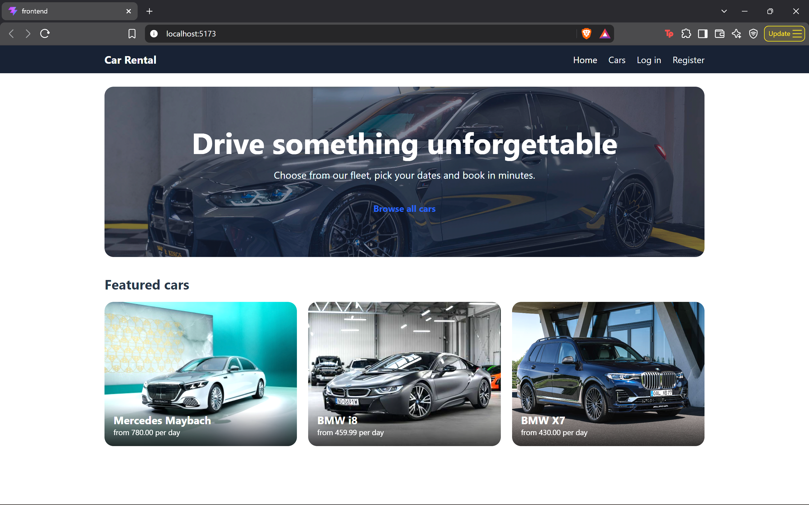
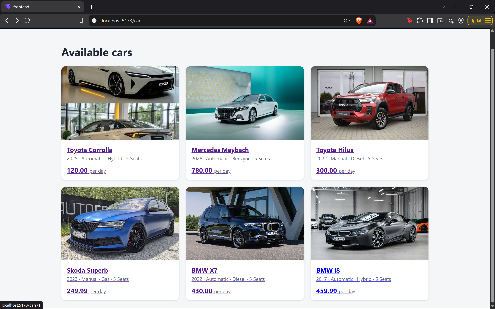
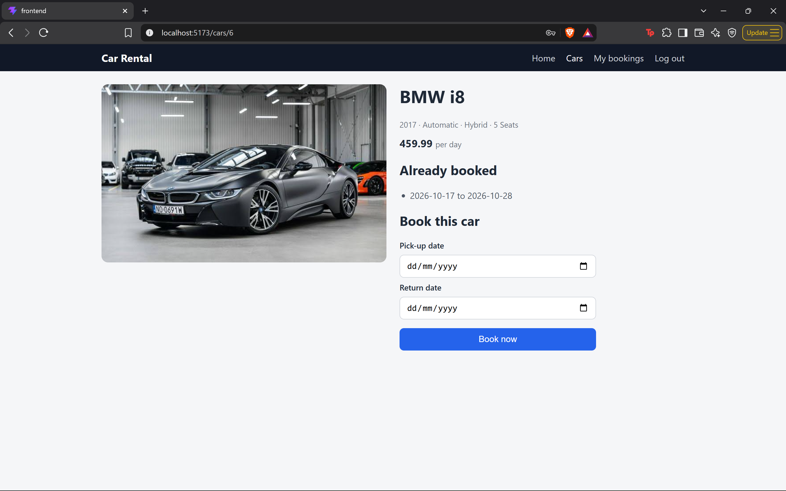
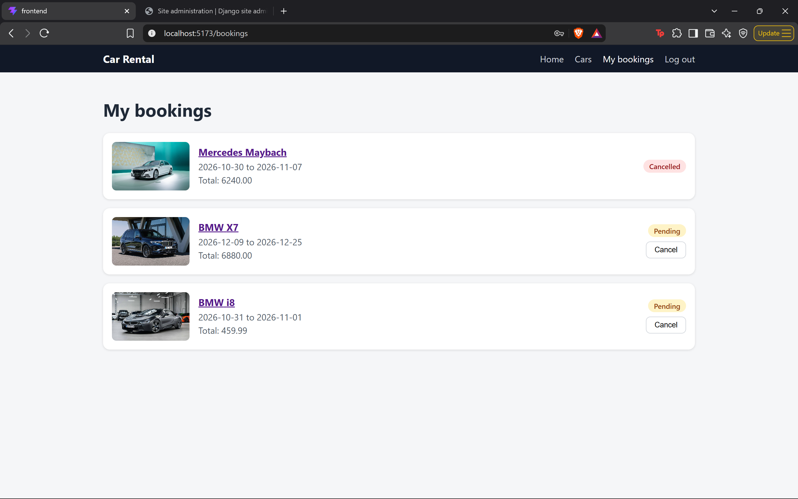
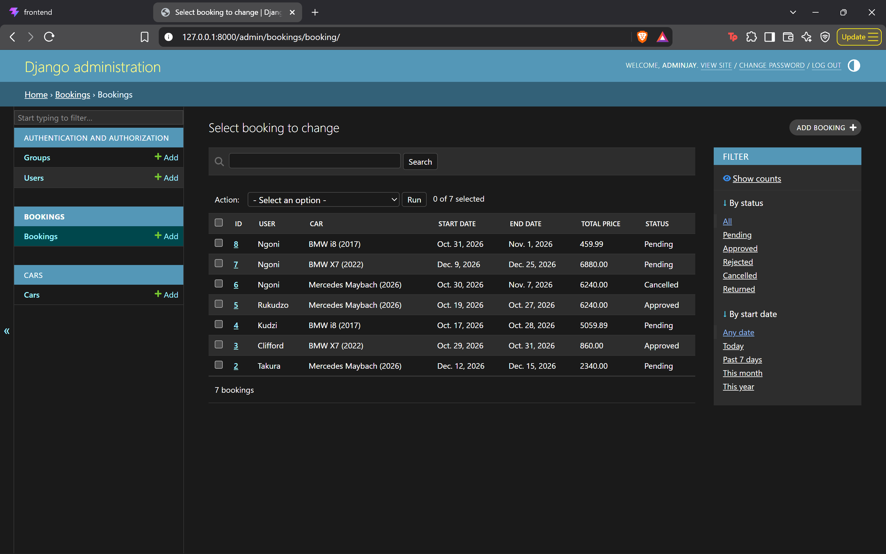
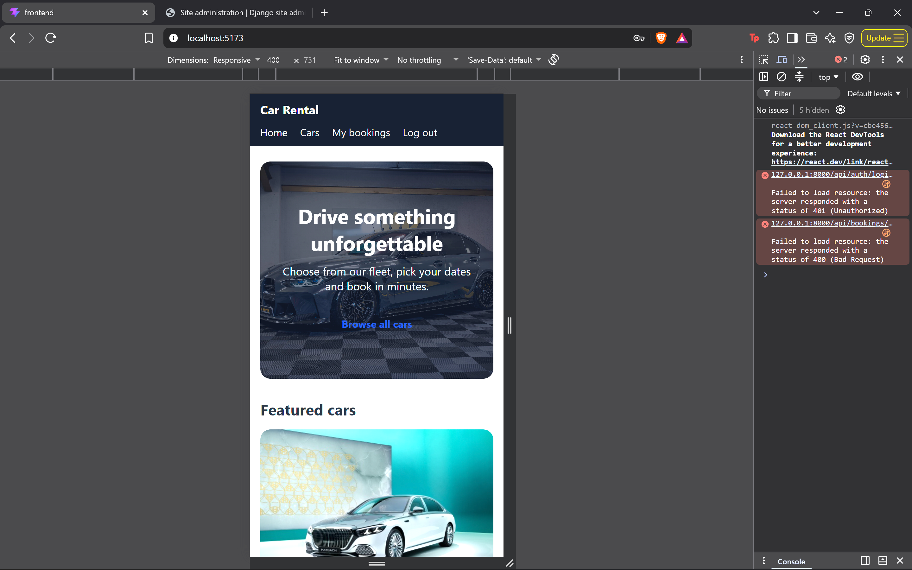

# Car Rental App

A responsive car rental web application. Customers browse and filter cars, check availability by date, register, log in and book. Staff approve and manage bookings in an admin panel.

Built as my final year computer science project.



## Features

- Browse cars, with search, filters (transmission, fuel) and sorting by price
- Date-based availability: cars already booked for the chosen dates are hidden
- Registration and login with JWT authentication, hashed passwords
- Booking form with a live price estimate
- Overlap-proof bookings: a car cannot be booked twice for the same dates, but back-to-back bookings are allowed
- Price is calculated on the server, so clients cannot set their own
- "My bookings" page with status labels and cancellation
- Admin panel to add cars, and to approve, reject or mark bookings as returned
- Responsive layout (desktop, tablet, phone)

## Tech stack

| Part | Technology |
|---|---|
| Backend | Python, Django, Django REST Framework |
| Authentication | JWT (SimpleJWT) |
| Database | SQLite (development) |
| Frontend | React, TypeScript, Vite |
| Routing | React Router |
| Tests | Django test framework |

## Screenshots

| Cars | Booking |
|---|---|
|  |  |

| My bookings | Admin |
|---|---|
|  |  |



## How it works

```
React (port 5173)  -->  REST API (port 8000)  -->  Django rules  -->  Database
   what users see        JSON over HTTP           overlap check,       cars, bookings,
                                                   price calculation    users
```

The frontend never touches the database. It calls the API, and Django enforces the rules, so a booking that breaks them is rejected even if the browser is bypassed.

## Getting started

You need Python 3.12 or newer and Node.js 20 or newer.

### Backend

```bash
cd Backend
python -m venv venv
venv\Scripts\activate          # macOS/Linux: source venv/bin/activate
pip install -r requirements.txt
copy .env.example .env         # macOS/Linux: cp .env.example .env
python manage.py migrate
python manage.py createsuperuser
python manage.py runserver
```

Open `.env` and replace `SECRET_KEY` with a random value. Add cars in the admin at `http://127.0.0.1:8000/admin/`.

### Frontend

```bash
cd frontend
npm install
npm run dev
```

The app runs at `http://localhost:5173`.

### Tests

```bash
cd Backend
python manage.py test
```

## API overview

| Method | Address | What it does |
|---|---|---|
| POST | `/api/auth/register/` | Create an account |
| POST | `/api/auth/login/` | Get an access token |
| GET | `/api/cars/` | List cars (supports `search`, `transmission`, `fuel_type`, `ordering`, `start_date`, `end_date`) |
| GET | `/api/cars/<id>/` | One car |
| GET | `/api/cars/<id>/booked-dates/` | Dates already taken |
| POST | `/api/bookings/` | Create a booking (login required) |
| GET | `/api/bookings/` | My bookings (login required) |
| POST | `/api/bookings/<id>/cancel/` | Cancel a booking |

## Design decisions

- **Booking rule in one place.** The overlap check lives in the model's `clean()` method, and both the admin and the API use it.
- **Status flow.** Bookings move forward only: pending, approved, returned. Cancelling is allowed from pending or approved.
- **Price stored on the booking.** Changing a car's daily rate later does not change old bookings.
- **Types and validation.** TypeScript describes the data on the frontend, and Django validates it on the backend.

## Future work

- Online payments
- Email confirmation
- Reviews and ratings
- Deployment with a hosted database

## Credits

Car photos: [google photos]